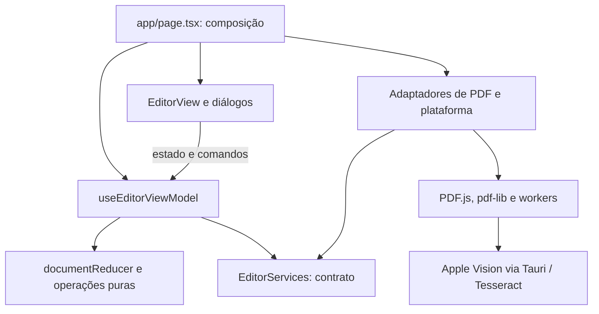

# Arquitetura do PDF Smart

Revisão em 14/10/2026. A mudança separa a interface do estado e dos comandos do editor; preserva a classificação heurística, os workers e os limites do processamento local.

## Decisão

MVVM adaptado ao React: componentes funcionais representam a View, hooks representam o ViewModel, e funções/reducers puros representam o Model. Não há necessidade atual de Redux, contêiner de injeção, classes base ou eventos globais. Os serviços são injetados como um objeto tipado no ponto de composição `app/page.tsx`.

A orientação do [React para custom hooks](https://react.dev/learn/reusing-logic-with-custom-hooks) permite separar lógica com estado; [reducers](https://react.dev/learn/extracting-state-logic-into-a-reducer) consolidam transições complexas. A [descrição de MVVM da Microsoft](https://learn.microsoft.com/dotnet/architecture/maui/mvvm) sustenta a separação entre apresentação, estado/comandos e dados/regras; aqui a implementação acompanha os recursos do React.

## Responsabilidades e dependências

| Área | Responsabilidade | Regra |
| --- | --- | --- |
| `app/page.tsx` | Compor ViewModel, serviços e View | Não conter regras de edição |
| `features/editor/model/document.ts` | Histórico, seleção e transformações de páginas | Sem React, DOM ou execução de bibliotecas de PDF |
| `features/editor/model/editor-services.ts` | Contratos das operações externas | Apenas tipos; implementação injetada |
| `features/editor/view-model/` | Coordenar estado, comandos, progresso e operações | Não importar implementações de PDF ou plataforma |
| `features/editor/views/` | Renderizar editor, progresso, configurações e diálogos | Acionar comandos; não executar transformações de páginas |
| `hooks/use-page-preview.ts` | Gerenciar requisições e recursos da ampliação | Receber a função de renderização; invalidar respostas antigas |
| `lib/platform/` | Adaptar serviços e downloads do navegador/WebView | Ser substituível sem mudar as regras do editor |
| `lib/pdf/` | Importar, renderizar, analisar, exportar e comprimir | Manter classificação separada do OCR e da renderização |
| `src-tauri/` | IPC e ciclo de vida do OCR Swift | Validar entradas e impor prazo ao processo |

`useDocumentBridge` isola o registro WebMCP e o aviso de saída. `useEditorOperation` concentra o bloqueio síncrono, o estado ocupado e o pedido de cancelamento. O cancelamento continua ocorrendo entre páginas; não promete interromper imediatamente uma leitura em andamento.

## Achados e mudanças aplicadas

- **Interface e aplicação misturadas:** o arquivo da rota tinha 1.565 linhas. A rota virou apenas composição; a apresentação está dividida em editor, progresso, configurações, exportação e ampliação.
- **Histórico distribuído em vários setters:** páginas, seleção, histórico e refazer passam por um reducer com transições atômicas. Edição após desfazer invalida refazer; o histórico tem limite de 20 entradas. Commit elimina IDs selecionados que já não existem.
- **Importação incremental e histórico:** atualizações temporárias de importação/análise não criam edições. O commit da importação usa explicitamente o documento anterior, para desfazer o lote inteiro, sem guardar uma versão parcial como estado anterior.
- **Transformações dentro do JSX:** mover, girar e duplicar são funções puras; IDs novos entram por função fornecida pelo chamador. A View usa comandos do ViewModel.
- **Dependência direta de infraestrutura:** `EditorServices` permite substituir importação, OCR/análise, exportação, compressão, renderização e saída de arquivos em testes ou numa futura integração de sistema.
- **Download duplicado:** exportação e divisão/compressão usam um único adaptador, com liberação da URL mesmo se o disparo do download falhar.
- **Ciclo de operação repetido:** início, finalização e cancelamento são centralizados. A espera para pintar a interface fica dentro do bloco protegido por `try/finally`.

## Pontos preservados

Classificação e regras de scan já estavam separadas em módulos específicos. Exportação e compressão usam workers, transportam referências mínimas e limitam imagens em voo. O cache é limitado e não guarda buffers completos de OCR. O OCR nativo tem watchdog e alternativa local. Essas escolhas foram mantidas.

O [modelo de processos do Tauri](https://v2.tauri.app/concept/process-model/) reforça a separação entre WebView e processamento nativo. Mudanças futuras de IPC devem considerar os [limites de confiança e capabilities](https://v2.tauri.app/security/capabilities/), concedendo somente as operações necessárias.

## Próximas prioridades identificadas

As prioridades de sessão explícita, contratos de workers e encerramento foram tratadas na versão 0.1.7, descrita abaixo.

1. **ViewModel menor se o produto crescer:** ele ainda coordena múltiplos fluxos. Dividir importação, análise e exportação em hooks/casos de uso específicos quando os contratos se estabilizarem, evitando substituir um componente grande por um hook sem fronteiras internas.
2. **Cobertura de integração:** testes puros e de workers não substituem cenários no WebView: abrir PDFs reais, cancelar OCR, fechar/reabrir, documentos grandes, falha de disco e exportação offline. Não há benchmark que demonstre ganho de velocidade por esta refatoração.
3. **Publicação:** o projeto ainda não tem arquivo `LICENSE`. A escolha cabe ao autor. Documentar os requisitos de build e preservar avisos das dependências e recursos empacotados antes de publicar.

## Verificação

`npm test` cobre classificação, workers, cache, prazos do OCR e as transições do novo modelo. `npm run typecheck` e `npm run lint` verificam contratos e regras do React. O workflow de qualidade executa esses comandos e o build do frontend desktop em pushes e pull requests. Os testes usam `module.registerHooks`, disponível desde Node 22.15, conforme a [documentação do Node](https://nodejs.org/api/module.html#moduleregisterhooksoptions); o requisito declarado foi corrigido e a CI usa Node 24. O build macOS continua usando `npm run desktop:build`.

Os novos testes exercitam sequências de edição/desfazer/refazer, invalidação do refazer, retenção limitada, snapshot da importação incremental, atualização de evidências sem novo histórico, seleção após remoção e preservação das fontes ao duplicar/girar.

Validação local desta revisão: 42 testes passaram; checagem de tipos, lint, build Tauri macOS, assinatura local e integridade do ZIP passaram. Na prévia web foram verificados criação de página, seleção, duplicação, desfazer/refazer, análise de páginas vazias, configurações, ampliação, revisão com avanço e exportação. O PDF exportado pela interface foi aberto por pdf-lib e confirmou duas páginas. Isso não cobre importação de PDFs reais no WebView nem valida o novo workflow numa execução do GitHub Actions.

## Sessões e workers 0.1.7

`createPdfSession` cria um `SessionResources` por editor. Documentos PDF.js, URLs de miniaturas, evidências de OCR e tarefas ativas pertencem à instância. A coleta de referências fica suspensa durante tarefas ativas; uma revisão de recursos impede que um snapshot antigo descarte documentos recém-importados. O encerramento é idempotente, bloqueia novos comandos, aborta o sinal da sessão e aguarda as tarefas e as destruições já iniciadas antes de limpar mapas e cache.

`createEditorSessionStore` aloca a sessão durante a assinatura do editor, por `useSyncExternalStore`. Renderizações descartadas não criam documentos ou workers. O ciclo de montar/desmontar/montar do StrictMode gera uma instância nova, sem reusar a sessão já encerrada. O último consumidor libera a sessão.

`worker-protocol.ts` define uniões discriminadas para exportação, compressão e OCR e valida mensagens em tempo de execução. `requestWorker` separa progresso de resposta final, rejeita mensagens malformadas ou inesperadas, remove handlers e timers ao concluir, e termina o worker em abort, erro ou timeout. O prazo de exportação/compressão é 120 segundos por pedido; não é renovado por mensagens de progresso. Esses limites protegem contra esperas indefinidas e não representam previsão de duração para PDFs grandes.

Tesseract roda dentro de um host pertencente à análise, inclusive durante sua inicialização. Inicialização, parâmetros e cada leitura têm prazo de 30 segundos. Um host que falha ou expira é marcado como indisponível pelo restante da análise; as páginas seguintes não repetem a espera num worker já terminado. O encerramento do host termina o worker dedicado que ele criou, conforme o [ciclo de vida de workers no HTML Standard](https://html.spec.whatwg.org/multipage/workers.html#the-worker's-lifetime). O modelo `eng` agora é servido do pacote local tanto no desktop quanto na versão web. O host só retorna texto e confiança, sem transportar as estruturas internas completas do Tesseract. A imagem é enviada em PNG/data URL, limitada pelo canvas de análise e pelo contrato de 24 milhões de caracteres; essa codificação tem custo e não há benchmark de ganho de velocidade.

O sinal da sessão também cancela esperas de preparação da imagem e a renderização PDF.js. Resultados e callbacks após encerramento são ignorados, e novos downloads de uma sessão encerrada são rejeitados. O pedido manual de parar a análise continua sendo entre páginas. O processo Apple Vision continua pertencendo ao host Tauri; cancelar a espera de IPC no frontend não promete interromper imediatamente o Vision. O watchdog nativo de 8 segundos permanece responsável por chamadas presas.

Validação desta etapa: testes de isolamento entre sessões, retenção de desfazer durante consumo ativo, coleta baseada em snapshot antigo, encerramento com worker ativo, destruição já iniciada, remontagem em StrictMode, contrato de mensagens, prazos e OCR com modelo empacotado. Na prévia foram importadas as três páginas de um PDF sintético. Um teste de navegador dedicado reconheceu EM BRANCO com confiança 92% pelo novo host OCR local. A seleção de arquivo da prévia falhou durante outra tentativa; o fluxo completo de análise do PDF nesse WebView continua pendente. O teste direto do host em Node também reconheceu o carimbo e verificou liberação e recuperação após erro.

Resultado final automatizado da etapa 0.1.7: 68 testes passaram, além de checagem de tipos e lint. O modelo local foi reconhecido no navegador e no teste direto em Node. A leitura PNG/data URL e os prazos dos workers foram verificados; o teste completo com PDF real no aplicativo macOS, durante cancelamento/fechamento, permanece como validação adicional.
